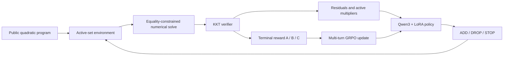

# KKT_LLM: learning active-set repair with verifiable feedback

[中文介绍](README_ZH.md) · [Reproduction guide](docs/REPRODUCING.md) · [Method](docs/METHOD.md) · [Recorded experiment](reference/report/research_report.md)

**Can mathematical optimality checks teach a language model to make better optimization decisions?** This project studies that question using Qwen3-0.6B, LoRA supervised fine-tuning (SFT), and multi-turn group relative policy optimization (GRPO) on strictly convex quadratic programs.

The language model chooses **`ADD(i)`, `DROP(i)`, or `STOP`** to repair an active constraint set. A numerical solver computes the candidate primal/dual variables. An independent verifier checks all four Karush–Kuhn–Tucker (KKT) conditions and supplies feedback and rewards. The learning task is the discrete repair policy; numerical linear algebra remains in the solver.



## What is included

- Deterministic generation of 7,000 feasible QPs, with separately stored oracle labels and independent OSQP validation.
- A numerically checked repair environment, scale-normalized KKT certificates, and random/greedy/classical/OSQP baselines.
- Oracle-teacher SFT, an auditable custom multi-turn GRPO implementation, three reward ablations, and checkpoint resume.
- Matched evaluation, saved episode-level results, training diagnostics, figures, and success/failure case studies.
- Release attachments containing the original data, four trained adapters, and raw evidence; the base Qwen weights are downloaded separately from Hugging Face at a fixed revision.

## Quick start: CPU only

Requires Python 3.11 or newer; the recorded environment uses Python 3.13.9.

```bash
git clone https://github.com/gaozhiweiPHD/KKT_LLM.git
cd KKT_LLM
python3 -m venv .venv
source .venv/bin/activate
python -m pip install -e '.[dev]'
bash scripts/reproduce.sh cpu
bash scripts/run.sh examples/active_set_demo.py
```

The demo solves a two-variable box-constrained QP and prints each repair action. It ends with `x = [1, 1]`, `success = True`, and a passing certificate. It uses the greedy baseline to illustrate the environment; it does not load or evaluate a language model.

For the recorded training environment, use Python **3.13.9** and `requirements.lock.txt`. The lightweight installation above validates the numerical components and omits PyTorch-dependent tests. See the [three reproduction routes](docs/REPRODUCING.md): inspect saved evidence, evaluate the trained adapters, or retrain everything.

## Main idea

We solve

$$\min_x \frac12 x^\top Qx+c^\top x\quad\text{subject to}\quad Ax\leq b,\qquad Q\succ0.$$

An active-set hypothesis determines an equality-constrained subproblem. Its solution may violate an inactive constraint or produce a negative multiplier. The policy uses these residuals to decide what to add or drop. Only an explicit `STOP` with **all four normalized KKT residuals ≤ 1e-5** counts as agent success. Exact KKT conditions imply the unique global primal optimum; the implemented floating-point check is an approximate certificate.

SFT first teaches the action format and repair decisions. GRPO then samples four complete trajectories from the same QP and initial set and updates the LoRA policy using group-relative terminal rewards:

| Reward | Definition |
|---|---|
| A | 1 for verified successful STOP, otherwise 0 |
| B | A + 0.5 × clipped log KKT-merit improvement |
| C | B − 0.01 × actions − 0.05 × invalid actions |

The main GRPO backend is implemented in `kkt_agent/grpo.py`; SFT uses TRL's `SFTTrainer`. The separate TRL tool-calling backend is experimental and was **not** part of the reported runs.

## Recorded results

Cold starts, at most 20 agent actions including STOP, 1,000 ID and 500 OOD problems, inference seeds 11/22/33. Values below are mean verified success rates. **All learned policies have only one training seed (42).**

| Method | ID | OOD |
|---|---:|---:|
| Qwen3 zero-shot | 0.00% | 0.00% |
| SFT | 78.57% | 81.07% |
| SFT + GRPO-A | 84.63% | 90.73% |
| SFT + GRPO-B | 85.10% | 87.40% |
| SFT + GRPO-C | 83.93% | 89.33% |
| Greedy repair | 90.20% | 96.20% |
| Classical active-set, 20 iterations | 90.00% | 86.20% |
| OSQP, independent solver budget | 100.00% | 100.00% |

GRPO-B improved ID success by **6.53 percentage points** over SFT in this run. Numerical baselines remain strong, and these results do not establish a robust ranking between reward variants or a speed advantage over QP solvers. OOD mixes dimensions, condition numbers, and constraint counts; its higher aggregate success is not evidence that every OOD case is harder. Full uncertainty, costs, tolerance sensitivity and limitations are in the [report](reference/report/research_report.md) and [comparison CSV](reference/results/comparison.csv).

## Repository map

| Path | Purpose |
|---|---|
| `kkt_agent/` | Generator, solvers, verifier, environment, policies and GRPO |
| `configs/` | SFT/GRPO hyperparameters and fixed base-model revision |
| `scripts/reproduce.sh` | CPU, data, training, evaluation and audit stages |
| `examples/active_set_demo.py` | Small, inspectable numerical example |
| `tests/` | Numerical invariants, action contract, rewards and GRPO gradients |
| `docs/` | Method, reproduction, artifacts and packaging notes |
| `reference/` | Frozen evidence from the original experiment |
| `data/`, `checkpoints/`, `results/`, `report/` | Downloaded/generated working files; excluded from Git |

The original experiment used one Quadro RTX 6000, FP16, LoRA rank 8 / alpha 16 (2,293,760 trainable parameters), 200 SFT updates and 200 updates for each GRPO variant. The reference SFT run read 12,000 supervised states and made about 800 sample presentations; it did not train over the entire teacher corpus.

See [METHOD.md](docs/METHOD.md) for oracle isolation, the certificate, observation limits and the GRPO objective, and [ARTIFACTS.md](docs/ARTIFACTS.md) for checksums and archive contents.
